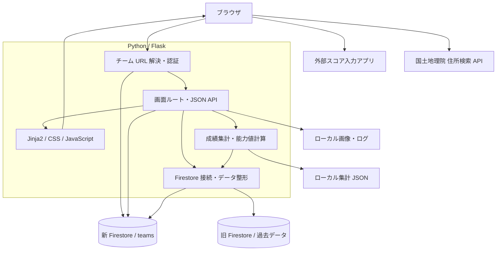
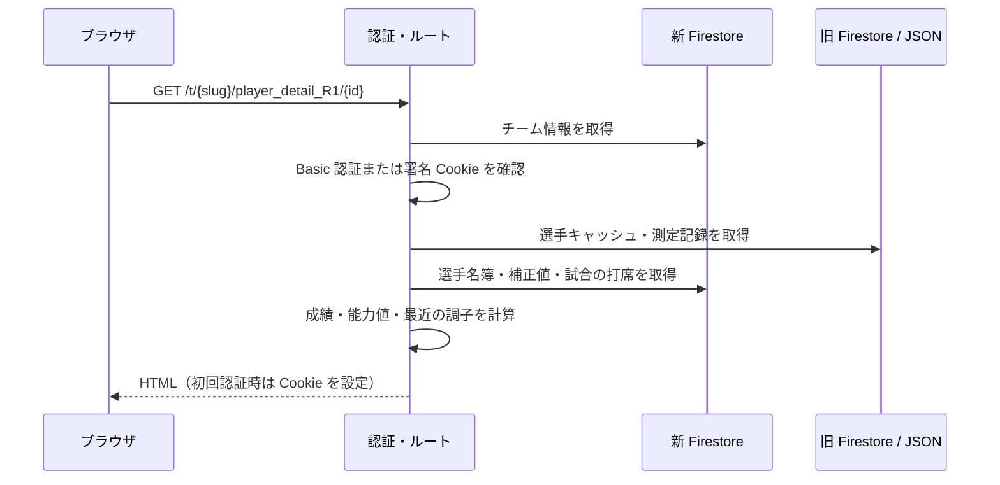
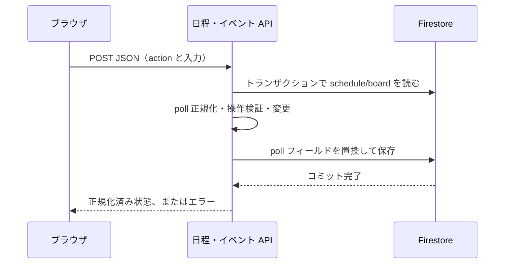

# BaseMob Web 設計書

作成日: 2026-10-14。対象: このリポジトリの Flask アプリの現行実装。

この設計書はコードをもとにした現状仕様です。Firestore の実データ、外部スコア入力アプリ、本番環境は調査対象に含めていません。Firestore はスキーマレスのため、データ定義の型・必須条件はアプリが保存・参照する形式を示し、DB が強制する制約ではありません。実装上の制約は各章と本書末尾に記載します。

## 文書一覧

| 文書 | 内容 |
| --- | --- |
| [画面定義・画面遷移](screens.md) | 全登録画面、表示項目、入力項目、保存・キャンセル・エラー時の挙動、遷移図 |
| [データ・テーブル定義](data-model.md) | Firestore のコレクション、ネスト構造、旧データ、キャッシュ、SQLite |
| [ビジネスルール](business-rules.md) | 認証、選手管理、日程・イベント、成績集計、能力値の判定 |
| [API・フォーム定義](api.md) | JSON API の action・入力・レスポンス、フォーム更新経路、エラー |

## システム構成

`app.py` が開発サーバーを起動し、`webapp/__init__.py` が Flask、認証フック、ルート、チーム URL 用 WSGI ミドルウェアを組み立てます。HTML と JSON API は同じ Flask アプリから配信します。

チーム別 URL は `/t/{slug}/...` です。`TeamPrefix` が接頭辞を外して既存ルートに渡し、`auth.py` が対象チームを解決します。テンプレート内の `url_for` は `tenant.py` によりチーム接頭辞を付与します。直接記述された `/games` などのリンクは、認証 Cookie を介したチーム URL へのリダイレクトに依存します。

新 DB はチーム別の名簿・試合・日程と設定を管理します。旧 DB は過去成績・能力計算のデータを供給します。これは完全にチーム分離された一つのデータモデルではなく、移行途中の構成です。

## 主要処理の流れ

## 実装上の制約・不整合

| ID | 内容 | 影響・根拠 |
| --- | --- | --- |
| K-01 | 旧データ読取と従来打席フォームの書込先が異なる | `data.py` は旧 DB の `game_records`、`routes/records.py` は新 DB のトップレベルへ保存。保存後のキャッシュ再集計に反映されない可能性 |
| K-02 | 日程操作の権限が画面と API で異なる | API の `add`・`remove`・`game`・`clear-game` にログイン必須チェックがない。画面でボタンを隠しても API の制限にはならない |
| K-03 | 「今年度」の一部集計に年フィルターがない | `annual.py`、`current_year_records.py`、選手詳細はチームの全試合を参照。名称だけで現在年に限定されると解釈しない |
| K-04 | チーム過去成績が固定値 | `teamstats.py` の2020～2025年のデータはコード内固定値で、チーム ID による切替がない |
| K-05 | 新チームの能力計算に旧名簿・キャッシュが関係する | 選手詳細は JSON を基礎に名簿を上書き。`prepare_frames.py` は旧名簿を起点に集計し、チームを完全分離しない |
| K-06 | 画面にある更新経路が未登録 | `/api/update_attr`、`/update_game_score/{id}` は対応ルートがない。`/api/schedule` の POST も未登録 |
| K-07 | 投手集計の参照構造が異なる | 試合詳細は投手サブコレクション優先、投手成績・チーム成績は試合文書内の `pitchers` 配列を参照 |
| K-08 | 画面によって打席結果の分類が異なる | 試合一覧、選手詳細、年度成績、旧キャッシュで異なる結果コード・文字列判定を持つ |
| K-09 | ID 採番・キャッシュ・画像は同時実行に制約がある | 選手 ID は最大値 + 1。JSON・画像はローカルファイルへ直接保存し、排他や DB とファイルの一括トランザクションはない |
| K-10 | Firebase 初期化は新旧2つを一括で扱う | 一方の鍵で初期化に失敗すると `db`・`db_old` の両方が `None` になる |
| K-11 | 認可はチーム共通 | 管理者と一般メンバーを区別するロールはなく、`/admin/` もチームログインと同じ認証 |
| K-12 | 一部 API の型検証・例外処理が限定的 | 能力更新の JSON が配列等の場合、型次第で500になり得る。フォームの整数変換や配列長にも包括的な検証がない |

これらは確認できた現状です。本設計書の作成ではアプリの動作や権限を変更していません。

## 運用・保守条件

- 起動方法と認証鍵の準備は [プロジェクト README](../../README.md) を参照します。
- 開発起動は `127.0.0.1:5000`、デバッグ有効。本番用 WSGI・HTTPS・デプロイ定義は未同梱です。
- ローカル画像の永続化とキャッシュ・ログへの書き込み権限が必要です。複数サーバー間のファイル共有は未実装です。
- 認証鍵を文書や Git に含めません。鍵ファイルは `.gitignore` で除外します。
- 自動テスト、DB スキーマ検証、監査ログ、汎用バックアップ復元 API は未同梱です。
- 仕様変更時はルート・フォーム・JavaScript・データ定義・権限表を同時に更新してください。
