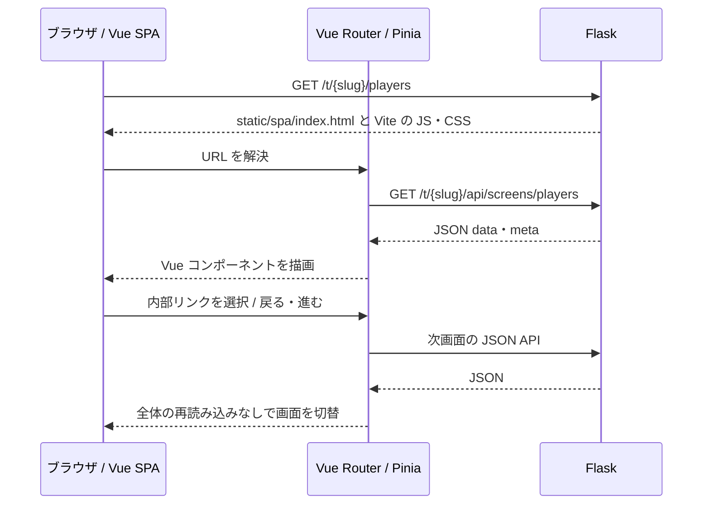

# Vue SPA と API の設計

[設計書トップ](README.md)

Vue 3・Vue Router 4・Pinia 3・Vite 7 を使用します。Python / Flask は認証、JSON API、Firestore、静的配信を担当します。ブラウザ内の画面生成・状態・操作は Vue が担当し、Nunjucks と描画後のスクリプト再実行は廃止しました。

## 画面起動・遷移



既存18画面の URL を Vue Router と Flask の両方で定義します。初回アクセスと再読み込みは Flask の既存 GET ルートが SPA シェルを返します。遷移時は RouterLink と router.push を使用し、年度などのクエリを画面 API に引き継ぎます。外部スコア入力と動画は通常の外部リンクです。

## クライアント構成

| 配置 | 役割 |
| --- | --- |
| `client/src/App.vue` | 共通ナビ・読込・エラー・画面描画 |
| `client/src/router.js` | 全18画面・履歴・URL・タイトル |
| `client/src/stores/screen.js` | Pinia の画面データ。前の通信を中断し、遅延応答の上書きを防止 |
| `client/src/api.js` | JSON 通信、チーム接頭辞、API URL |
| `client/src/composables/useSave.js` | FormData / JSON 保存、保存中の二重送信防止、保存後の遷移 |
| `client/src/composables/usePoll.js` | 日程・イベントの読込・保存・画面終了時の通信中断 |
| `client/src/views/` | 選手・成績・試合・設定・日程・イベントの Vue 画面 |
| `client/src/components/` | 表・画像・出欠フォーム・メンバー編集・住所検索などの共通部品 |
| `client/src/stats.js` | 従来クライアント側で行っていた状況別打率などの表示集計 |
| `client/src/scheduling/dates.js` | 従来の日付・祝日・候補日計算 |
| `client/src/styles.css` | SPA の共通レイアウト・レスポンシブ表示 |
| `static/style.css` と参照 CSS | 既存の共通スタイル |
| `static/spa/` | Vite が生成し、Flask が配信する成果物 |

画面データの `view` とルート一覧は既存 API の互換性を維持するため残しています。`view: "players.njk"` は旧識別子で、テンプレートファイルの読込・描画には使用しません。画面コンポーネントは Vue Router が選択します。

## 画面データ API

ベースパスは `/t/{slug}`。表の API は GET で使用します。クエリは画面 URL からそのまま引き継ぎます。

| 画面 | API | data の主な項目 |
| --- | --- | --- |
| 選手一覧 | `/api/screens/players` | players |
| 選手登録 | `/api/screens/register_player` | form |
| 選手編集 | `/api/screens/edit_player/{player_id}` | player |
| 選手詳細 | `/api/screens/player_detail_R1/{player_id}` | player, active_skills, records, annual_*, condition_*, recent_*, monthly_avg_data |
| 当年個人成績 | `/api/screens/current_year_stats/{player_id}` | player, records |
| 過去成績 | `/api/screens/player_history/{player_id}` | player, history_stats, total_stats, request |
| 従来打席入力 | `/api/screens/input_form_R1/{player_id}` | player |
| 試合一覧 | `/api/screens/games` | games, selected_year |
| 試合詳細 | `/api/screens/game/{game_id}` | game, batters, pitchers |
| チーム成績 | `/api/screens/teamstats` | stats, request, newest_game_year |
| 個人成績一覧 | `/api/screens/annual_stats_detail` | stats, team_total, regulation_pa |
| 投手成績 | `/api/screens/pitchers` | pitchers |
| 能力一覧 | `/api/screens/pawapuro` | players_data |
| 記録会まとめ | `/api/screens/record_summary` | records |
| 日程調整 | `/api/screens/schedule` | logged_in, roster, conditions |
| イベント | `/api/screens/events` | logged_in, roster |
| 規定打席 | `/api/screens/admin/regulation` | pa_coef, error, saved |
| 定性特殊能力 | `/api/screens/admin/qualitative_abilities` | players, abilities |

### レスポンス形式

```json
{
  "view": "players.njk",
  "data": {
    "team_name": "テストチーム",
    "team_id": "DEMO",
    "schedule_api": "/t/demo/api/schedule",
    "abilities_api": "/t/demo/api/update_abilities",
    "score_entry_url": "https://basemob-207a2.web.app/app.html?team=DEMO",
    "players": [{"player_id": 1, "name": "選手A", "no": "1", "image_path": "default.png", "pos1": "遊"}]
  },
  "meta": {
    "team_slug": "demo",
    "logged_in": true,
    "routes": {"players": "/players", "static": "/static/<path:filename>"},
    "screen_routes": {"/players": ["GET"]},
    "action_routes": {}
  }
}
```

例の meta は抜粋です。実際には全既存ルートと画面・更新経路を含みます。data は従来の表示コンテキストを構造化したものです。完成 HTML のフィールドは返しません。

`request` はクエリ辞書と path だけを渡します。Flask の g・session・認証鍵・チームのパスワードハッシュは渡しません。NumPy 数値は通常の JSON 数値へ、日付は ISO 文字列へ、非有限浮動小数は null へ変換します。

## 更新 API

メソッドは POST。入力項目・検証・保存先は既存の業務フォーム定義を継続します。クライアントは FormData を使用するため、画像も同じ API で送信できます。

| フォーム | 新しい API |
| --- | --- |
| 選手登録 | `/api/screens/register_player` |
| 選手編集 | `/api/screens/edit_player/{player_id}` |
| 規定打席保存 | `/api/screens/admin/regulation` |
| 定性特殊能力保存 | `/api/screens/admin/qualitative_abilities` |
| 従来打席保存 | `/api/actions/save_record/{player_id}` |
| 従来打席更新 | `/api/actions/update_game_record/{player_id}` |
| 従来打席削除 | `/api/actions/delete_game_record/{player_id}/{csv_index}` |
| スコアボード画像保存 | `/api/actions/game/{game_id}/scoreboard_image` |
| 動画リンク保存 | `/api/actions/game/{game_id}/youtube` |

保存後の内部302は `200 {"redirect":"/t/demo/players"}` のような JSON に変換し、Vue Router が移動します。フォーム検証で同じ画面を再表示する場合は `view/data/meta` にエラー・入力値を含めて返し、クライアントで再描画します。

日程・イベント・能力補正の既存 JSON API は従来のパスとレスポンスを維持します。未実装の属性更新・スコア更新は今回も実装対象に含めず、保存経路がなければクライアントがエラーを表示します。

## 認証・エラー・状態

- 公開 GET は日程・イベントのみ。それ以外の画面 API とフォーム更新は既存のチーム認証が必要です。Basic 認証・署名 Cookie・サーバー側権限を維持します。
- 401・404・500、ネットワーク障害は共通エラーを表示します。画面シェルが200でも、後続 API が失敗する場合があります。再試行と再ログインを用意します。
- 通常のデータは Vue のテキスト補間で表示し、利用者入力を HTML として挿入しません。
- 日程・イベントの回答、ゲスト、未定期日、メンバー編集、試合カードと打順、イベントの作成・編集・確定・削除は Vue の状態・フォームで管理します。
- 画面終了時に AbortController で通信を中断し、画像プレビューの Object URL を解放します。住所検索は国土地理院の既存 API を使います。
- DB とサーバー側の検証・計算は変更していません。旧 DB 読込と新 DB 書込の不整合、未実装の属性更新・スコア更新は既存の制約です。試合詳細のイニングスコアは表示に対応します。

## 開発・検証

`client/` で `npm ci`、`npm test`、`npm run build` を実行します。開発は Flask を5000番、`npm run dev` の Vite を5173番で起動し、`http://127.0.0.1:5173/t/{slug}/players` を開きます。API と静的資産は Vite のプロキシで同一オリジンとして扱います。

本番の Python 起動はコミット済み `static/spa/` を使用します。Node.js はフロントエンドの開発・ビルド・テストに使用します。詳細なコマンドは [README](../../README.md) を参照してください。

## 選手詳細の既存デザイン

`PlayerDetailView.vue` は旧 `player_detail_R1` の PC（1200px 固定・769px以上）とスマートフォン（768px以下）のレイアウトを再現します。ホームと同じ上部タブ・余白をこの画面にも適用します。「トップページへ戻る」は廃止し、上部タブと画面内メニューで遷移します。

`components/player-detail/legacy.css` は旧画面の CSS を `.player-detail-page` 内に限定したものです。能力カード、守備位置による名前帯、色付きランク、特殊能力の空き枠、弾道・調子・球場画像を継続します。補正は編集ボタンでスライダーを有効化し、PC・モバイル間で値を同期します。旧画面の段階別ポイント単価と上限判定、元能力値への加算を再現します。月別打率は Chart.js を npm 依存として同梱し、画面終了時にグラフを破棄します。サーバーの API と計算は変更しません。

## 全画面の共通デザインと上部タブ

`client/src/styles.css` にモダンな共通スタイルを定義します。背景は `#f5f7fb`、カードは白、枠線は `#e2e8f0`、主要操作は `#2563eb` です。丸みのあるカード、控えめな影、余白、読みやすい文字、薄いグレーの表見出しを全画面で使用します。上部タブと外側の幅・余白は選手詳細も他ページと共通です。

選手詳細の選手情報部分はパワプロ風の水色の能力カード、守備位置別の名前帯、色付きランク、特殊能力、補正スライダー、球場図、調子アイコンを維持します。旧デザインの CSS は選手詳細内に限定し、共通デザインへ影響させません。「トップページへ戻る」は PC・スマートフォンとも表示しません。

`AppNav` の上部タブは全18画面で表示します。画面データとは別にナビゲーション情報を保持し、画面遷移中・API エラー時にもタブを残します。チーム切替時はナビ情報をリセットします。公開画面では従来どおり日程・イベントの公開項目を表示し、会員向けの項目・認証・API 権限は維持します。768px以下ではタブを折り返し表示します。

## 共通アイコン

`components/AppIcon.vue` の SVG アイコンを上部タブ、画面見出し、保存・編集・追加・削除・検索・出欠などの操作、成功・エラー表示に使用します。画面と機能の対応は `components/icons.js` で定義します。文字ラベルを残し、同じ機能には同じアイコンを使用します。装飾 SVG は `aria-hidden` と `focusable="false"` を指定し、ボタンの読み上げは文字ラベルに任せます。アイコンはアプリに同梱し、外部アイコン配信サービスへ依存しません。選手詳細のパワプロ風カードは維持し、画面内ナビに共通アイコンを追加します。

## スケジュール画面の旧レイアウトの取り込み

SPA 化前の調整ボード・回答シート・試合カードを Vue コンポーネントで再構成し、現在のモダンな共通色・カード・アイコンに合わせます。`components/schedule/ScheduleBoard.vue` は午前・午後の人数メーター、7人の手配候補、9人の目安、日付・曜日・祝日、折りたたみ式の出欠内訳と名前チップを表示します。`AttendanceForm` の sheet モードはボタン式の出欠選択と未定期日を表示し、イベントの既存フォームには影響させません。`ScheduleGameCard.vue` は会場・時刻・ユニフォーム・バット条件、守備位置別の色付き打順表と調子アイコンを表示します。過去カードは折りたたみできます。

日程追加、回答メンバー編集、回答用リンクのコピー、試合編集・削除は現在の API を使用します。編集ボタンを押すと編集フォームへスクロールします。レイアウトは `components/schedule/schedule.css` で専用クラスに限定し、スマートフォンでは縦配置に切り替えます。業務 API・保存先・認証は変更しません。
