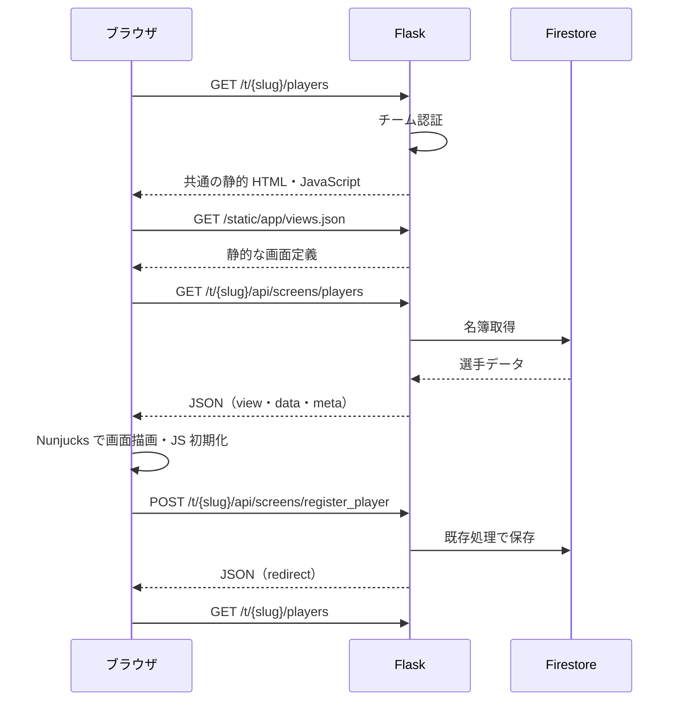

# API＋JavaScript の画面構成

[設計書トップ](README.md) / [画面定義](screens.md) / [既存 API・業務フォーム](api.md)

全18画面を、JSON の画面データ API とブラウザ描画へ移行しています。画面 URL、endpoint 名、認証、成績計算、Firestore の読み書き先は継続します。サーバーから完成した画面 HTML を取得する方式は終了し、共通の静的 HTML と JavaScript を配信します。

## 処理の流れ



画面間の移動は既存 URL への通常のページ遷移です。遷移先で静的シェル・API 読込・クライアント描画を行います。SPA のクライアントルーターは導入していません。

## ファイル構成

| 配置 | 内容 |
| --- | --- |
| `webapp/presentation/pages.py` | 画面・更新 API の登録、JSON 化、保存後のリダイレクト変換、例外応答 |
| `webapp/routes/` | 既存の取得・集計・保存処理。画面データを `screen_response` に渡す |
| `static/app/shell.html` | 全画面共通の静的 HTML。読込中・JavaScript 無効時の案内 |
| `static/app/app.js` | 画面起動、HTML の DOM への反映、画面 JS の初期化、フォーム送信・移動・エラー表示 |
| `static/app/api.js` | チーム URL、JSON 通信、フォームから更新 API への経路解決 |
| `static/app/renderer.js` | Nunjucks 環境、URL 生成、数値書式、名前空間操作、JSON エスケープ |
| `client/views/*.njk` | ブラウザ側の画面テンプレート |
| `client/views/parts/` | ブラウザ側の画面部品 |
| `static/app/views.json` | テンプレートの配信用バンドル。利用者データは含まない |
| `scripts/build_client_views.py` | `.njk` を配信用 JSON にまとめる |
| `static/vendor/` | 固定バージョンの Nunjucks 3.2.4 とライセンス |

従来の `templates/` は `client/views/` へ移し、Flask のサーバーテンプレートは使用しません。既存 CSS・日程・イベント JS は引き続き `static/` から配信します。

## 画面データ API

ベースパスは `/t/{slug}`。表の API は GET で使用します。クエリは画面 URL からそのまま引き継ぎます。

| 画面 | API | data の主な項目 |
| --- | --- | --- |
| 選手一覧 | `/api/screens/players` | players |
| 選手登録 | `/api/screens/register_player` | form |
| 選手編集 | `/api/screens/edit_player/{player_id}` | player |
| 選手詳細 | `/api/screens/player_detail_R1/{player_id}` | player, active_skills, records, annual_*, condition_*, recent_*, monthly_avg_data |
| 当年個人成績 | `/api/screens/current_year_stats/{player_id}` | player, records |
| 過去成績 | `/api/screens/player_history/{player_id}` | player, history_stats, total_stats, request |
| 従来打席入力 | `/api/screens/input_form_R1/{player_id}` | player |
| 試合一覧 | `/api/screens/games` | games, selected_year |
| 試合詳細 | `/api/screens/game/{game_id}` | game, batters, pitchers |
| チーム成績 | `/api/screens/teamstats` | stats, request, newest_game_year |
| 個人成績一覧 | `/api/screens/annual_stats_detail` | stats, team_total, regulation_pa |
| 投手成績 | `/api/screens/pitchers` | pitchers |
| 能力一覧 | `/api/screens/pawapuro` | players_data |
| 記録会まとめ | `/api/screens/record_summary` | records |
| 日程調整 | `/api/screens/schedule` | logged_in, roster, conditions |
| イベント | `/api/screens/events` | logged_in, roster |
| 規定打席 | `/api/screens/admin/regulation` | pa_coef, error, saved |
| 定性特殊能力 | `/api/screens/admin/qualitative_abilities` | players, abilities |

### レスポンス形式

```json
{
  "view": "players.njk",
  "data": {
    "team_name": "テストチーム",
    "team_id": "DEMO",
    "schedule_api": "/t/demo/api/schedule",
    "abilities_api": "/t/demo/api/update_abilities",
    "score_entry_url": "https://basemob-207a2.web.app/app.html?team=DEMO",
    "players": [{"player_id": 1, "name": "選手A", "no": "1", "image_path": "default.png", "pos1": "遊"}]
  },
  "meta": {
    "team_slug": "demo",
    "logged_in": true,
    "routes": {"players": "/players", "static": "/static/<path:filename>"},
    "screen_routes": {"/players": ["GET"]},
    "action_routes": {}
  }
}
```

例の meta は抜粋です。実際には全既存ルートと画面・更新経路を含みます。data は従来の表示コンテキストを構造化したものです。完成 HTML のフィールドは返しません。

`request` はクエリ辞書と path だけを渡します。Flask の g・session・認証鍵・チームのパスワードハッシュは渡しません。NumPy 数値は通常の JSON 数値へ、日付は ISO 文字列へ、非有限浮動小数は null へ変換します。

## 更新 API

メソッドは POST。入力項目・検証・保存先は既存の業務フォーム定義を継続します。クライアントは FormData を使用するため、画像も同じ API で送信できます。

| フォーム | 新しい API |
| --- | --- |
| 選手登録 | `/api/screens/register_player` |
| 選手編集 | `/api/screens/edit_player/{player_id}` |
| 規定打席保存 | `/api/screens/admin/regulation` |
| 定性特殊能力保存 | `/api/screens/admin/qualitative_abilities` |
| 従来打席保存 | `/api/actions/save_record/{player_id}` |
| 従来打席更新 | `/api/actions/update_game_record/{player_id}` |
| 従来打席削除 | `/api/actions/delete_game_record/{player_id}/{csv_index}` |
| スコアボード画像保存 | `/api/actions/game/{game_id}/scoreboard_image` |
| 動画リンク保存 | `/api/actions/game/{game_id}/youtube` |

保存後の内部302は `200 {"redirect":"/t/demo/players"}` のような JSON に変換し、ブラウザが移動します。フォーム検証で同じ画面を再表示する場合は `view/data/meta` にエラー・入力値を含めて返し、クライアントで再描画します。

日程・イベント・能力補正の既存 JSON API は従来のパスとレスポンスを維持します。未実装の属性更新・スコア更新は今回も実装対象に含めず、保存経路がなければクライアントがエラーを表示します。

## 認証・エラー・描画

- 画面データ API の公開 GET は日程・イベントのみ。それ以外と新しいフォーム更新 API はチームログインが必要です。
- 認証フックの401は従来どおり WWW-Authenticate とテキストです。クライアントは JSON を読めない認証エラーも扱います。
- 対象データなしは404 JSON、画面 API の未処理例外は500 JSON。画面シェル自体は200でも、後続のデータ API がエラーになる場合があります。
- 読込・保存失敗は共通メッセージ、初回読込失敗時は再読み込みボタンを表示します。フォーム保存中は二重送信を抑止します。
- 通常の値は autoescape を有効にして描画します。script 内の JSON は `<`、`>`、`&`、引用符等を Unicode エスケープします。
- テンプレートはアプリ内の信頼された画面定義のみを使用し、利用者からテンプレートを受け付けません。
- 既存の画面 JS は描画後に実行し、チャート等の DOM 準備完了処理を通知します。画像選択の自動保存は requestSubmit で API 送信につなぎます。

Nunjucks の描画・Loader・Jinja 互換機能の仕様は [公式 API 文書](https://mozilla.github.io/nunjucks/api.html) を参照します。Jinja の名前空間代入・タプル・文字列スライスはクライアント側の等価な表現へ移しています。

## 開発・検証

```bash
python scripts/build_client_views.py
python scripts/build_schedule_js.py
python -m unittest discover -s tests -v
node tests/test_client.cjs
```

ビルド済みの views.json と schedule_board.js を同梱するため、通常起動は従来どおり `python app.py` です。実行時に Node.js や npm は不要です。クライアント画面定義を変えた場合は JSON を再生成してください。

検証では、模擬 DB による19件の Python テスト、全クライアントテンプレートのコンパイル・エスケープ・数値表示・空状態の JS テスト、全18画面の移行前後の表示比較を行っています。Chrome でも全18画面の描画と選手登録から一覧への遷移を確認しました。実 Firestore への書き込みは行っていません。
