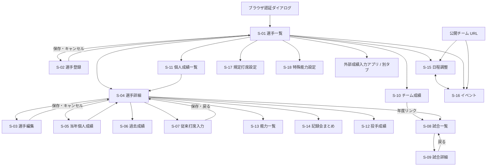

# 画面定義・画面遷移

[設計書トップ](README.md) / [API 定義](api.md) / [ビジネスルール](business-rules.md)

## 共通仕様

すべての画面パスには `/t/{slug}` が付きます。例: `/t/demo/players`。日程・イベント以外はチームログインが必要です。ログイン画面は HTML として持たず、ブラウザの HTTP Basic 認証ダイアログを使用します。

`/` は選手一覧へ302リダイレクトします。共通メニューは Vue の AppNav が全18画面で表示し、画面遷移中・エラー時にも残します。全画面は選手詳細の白・水色・青枠・黄色アクセントを共通の画面テイストとします。全18画面は初回に共通の静的 HTML を取得し、画面データ API の JSON を Vue コンポーネントで描画します。その後の内部画面遷移は Vue Router が管理します。日程・イベントは既存 JSON API を使用し、Vue の状態とフォームで表示・更新します。表の Vue ファイルは `client/src/views/` 配下です。画面定義は `client/src/views/`、共通部品は `client/src/components/` に配置しています。

## 画面一覧

「会員」は対象チームの共通認証を通過した利用者、「公開」は対象チームが存在すれば未ログインでもアクセスできる画面を示します。

| ID | 画面 / URL（GET） | 権限 | 主な表示・操作 | 実装 |
| --- | --- | --- | --- | --- |
| S-01 | 選手一覧 `/players` | 会員 | 名前・背番号・画像・主ポジション。詳細へのカードリンク、共通メニュー | `index_players.py` / `PlayersView.vue` |
| S-02 | 選手登録 `/register_player` | 会員 | 名前・背番号・ポジション・投打・画像の入力 | `players.py` / `PlayerFormView.vue` |
| S-03 | 選手編集 `/edit_player/{player_id}` | 会員 | 名前・背番号・主副ポジション・投打・生年月日・画像の編集 | `players.py` / `PlayerFormView.vue` |
| S-04 | 選手詳細 `/player_detail_R1/{player_id}` | 会員 | 選手属性、能力値・補正・特殊能力、成績、打球方向、月別打率、直近の調子 | `player_detail.py` / `PlayerDetailView.vue` |
| S-05 | 当年個人成績 `/current_year_stats/{player_id}` | 会員 | 試合・打席結果を表示 | `current_year.py` / `StatsView.vue` |
| S-06 | 過去成績 `/player_history/{player_id}` | 会員 | 年度別成績・合計、年・試合区分の絞込 | `history.py` / `StatsView.vue` |
| S-07 | 従来打席入力 `/input_form_R1/{player_id}` | 会員 | 試合属性、各打席、試合単位の盗塁・得点等を入力 | `records.py` / `RecordFormView.vue` |
| S-08 | 試合一覧 `/games` | 会員 | 試合カード、日付・対戦相手・得点、画像、動画、年の絞込 | `games.py` / `GamesView.vue` |
| S-09 | 試合詳細 `/game/{game_id}` | 会員 | スコアボード・打者・投手成績、画像・動画登録 | `game_detail.py` / `GameDetailView.vue` |
| S-10 | チーム成績 `/teamstats` | 会員 | 年別試合数・勝敗・勝率・得失点・打率・防御率など、年・区分の絞込 | `teamstats.py` / `StatsView.vue` |
| S-11 | 個人成績一覧 `/annual_stats_detail` | 会員 | 打者別集計、規定打席、チーム合計、選手詳細リンク | `annual.py` / `StatsView.vue` |
| S-12 | 投手成績 `/pitchers` | 会員 | 登板、投球回、被安打・四死球・奪三振・自責点、WHIP・ERA・K/BB | `pitchers.py` / `StatsView.vue` |
| S-13 | パワプロ風一覧 `/pawapuro` | 会員 | 選手能力値・ランク・特殊能力の一覧 | `abilities.py` / `AbilitiesView.vue` |
| S-14 | 記録会まとめ `/record_summary` | 会員 | 選手名と投・打・走等の測定記録 | `meeting.py` / `StatsView.vue` |
| S-15 | 日程調整 `/schedule` | 公開 | 日程ボード、回答、試合カード、回答者設定、打順・守備等 | `schedule.py` / `ScheduleView.vue` |
| S-16 | イベント `/events` | 公開 | 候補日・出欠・人数、作成・編集・確定・削除、回答者設定 | `events.py` / `EventsView.vue` |
| S-17 | 規定打席 `/admin/regulation` | 会員 | 1試合当たりの規定打席係数、保存完了・入力エラー | `regulation.py` / `SettingsView.vue` |
| S-18 | 定性特殊能力 `/admin/qualitative_abilities` | 会員 | 種類追加、能力ごとの選手チェック、保存 | `qualitative_abilities.py` / `SettingsView.vue` |
| S-19 | CSV 経路 `/csv_data` | 会員 | 現実装は選手一覧へ302。CSV テンプレートを表示しない | `csv_data.py` |
| EXT-01 | 成績入力（別アプリ） | 外部仕様 | `https://basemob-207a2.web.app/app.html?team={team_id}` を別タブで開く | `teams/urls.py` の `score_entry_url` |

試合成績・能力の細かな表示値は [ビジネスルール](business-rules.md) を参照します。ルート未登録の旧テンプレート（`add_player.njk`、`record_detail.njk` 等）は整理時に削除しました。

## 主要画面の項目定義

### S-02 選手登録

| 入力名 | 項目 | 必須・検証（サーバー） | 保存先 |
| --- | --- | --- | --- |
| `name` | 名前 | 前後空白除去後に空でない | `players.name` |
| `number` | 背番号 | 前後空白除去後に空でない。サーバーでは整数・重複検証なし | `number` と `no` |
| `position` | 主ポジション | 任意。サーバーでは列挙値検証なし | `pos1` |
| `throw_hand` / `bat_hand` | 投 / 打 | それぞれ `右`・`左`・`両` | 結合して `pitch_bat` |
| `image` | 画像 | 任意。対応拡張子、0より大きく8 MiB以下 | ローカル画像と `image_path` |

保存: 次の選手 ID を採番して名簿を merge 保存し、API の redirect を受けて選手一覧へ移動。エラー: 入力値とエラーメッセージを同じ画面で再表示（HTTP 200）。キャンセル: 選手一覧へ。

### S-03 選手編集

| 入力名 | 項目 | 画面・サーバーの扱い |
| --- | --- | --- |
| `name` | 名前 | HTML では必須。POST では値が送信されれば保存し、登録と同じ必須検証は行わない |
| `number` | 背番号 | HTML 数値入力。サーバーでは文字列として保存 |
| `pos1` / `pos2` / `pos3` | 主 / 副ポジション | UI は空・投・捕・一・二・三・遊・左・中・右。サーバーの列挙値検証なし |
| `pitch_bat` | 投打 | UI は右投右打・右投左打・右投両打・左投左打・左投右打・左投両打 |
| `birth_date` | 生年月日 | YYYY-MM-DD を案内するテキスト入力。サーバーの日付検証なし |
| `image_path` | 既存画像パス | `static/` 相対パス。絶対パス、`..`、コロン、NUL、240文字超を拒否。空は `default.png` |
| `image` | 新画像 | 任意。選択時は既存パスより優先してアップロード |

保存: 送信された属性と画像パスを merge 保存しAPI の redirect を受けて選手詳細へ移動。キャンセル: 選手詳細へ。画像エラー: フォームとメッセージを再表示。未登録 ID の GET に明示的な404判定はなく、空フォームになり得ます。

### S-04 選手詳細

基本属性は JSON キャッシュを基礎にチーム名簿を重ねます。試合内の打席・手入力集計値から成績を算出し、能力補正・定性フラグを表示します。補正の6項目は JSON API で更新します。対象がキャッシュにも名簿にもなければ画面データ API が404を返し、ブラウザがエラーを表示します。

### S-07 従来打席入力

試合日、試合 ID、球場、区分、打順、守備位置、盗塁・得点・打点・失策・併殺と、繰り返しの打席結果・方向・走者・ストライク・対左・サヨナラを入力します。保存するとAPI の redirect を受けて選手詳細へ移動です。旧 DB 名簿を参照するため、チーム名簿だけにいる選手では取得できない場合があります。書込先の相違は設計書 K-01 を参照します。

### S-09 試合詳細

| 操作 | 入力 | 結果 |
| --- | --- | --- |
| スコアボード画像保存 | `scoreboard_image` ファイル | 保存して詳細へ302。不正画像・未選択は変更せず302。試合なしは404 |
| 動画リンク保存 | `youtube_url` | HTTP(S) URL、500文字以下を保存。無効値は変更せず同じ画面へ移動。空欄による削除不可 |
| イニングスコア | 1～9回と合計を表示 | `/update_game_score/{id}` が未登録のため、SPA は表示のみ対応 |

YouTube の視聴リンクと ID 抽出を持ちますが、保存時に YouTube ドメインへ限定する検証はありません。

### S-15 日程調整

クエリ `view=board`（日程調整）、`view=answer`（出欠回答）、`view=game`（試合）で表示を切り替えます。未指定ではログイン時 `board`、公開時 `answer` を選びます。

当日から来月末までの候補日・人数・回答を表示し、日付の追加・削除、出欠入力、試合カード入力、回答者リストの設定を行います。試合カードは午前/午後、対戦相手、試合区分、球場・住所、ユニフォーム、バット条件、集合/開始時刻、ベンチ、10枠の名前・守備位置を持ちます。住所検索は国土地理院 API を呼びます。

画面上の人数判定には7人・9人の基準があります。これらは表示上の目安で、DB が試合成立を強制する条件ではありません。公開利用者にも回答機能があります。操作の実際の権限は [API 権限表](api.md) を参照します。

### S-16 イベント

名称、場所、住所、開始時刻、メモ、1～14の候補日を入力します。候補日ごとに参加・未定・不参加を回答し、未定時に回答期日を入力します。作成・編集・確定・削除・回答者設定はログイン時に操作します。保存成功時は API 応答で画面状態を更新し、入力エラー・通信エラーは画面内に表示します。画面シェル自体は200でも、対象データがなければ API 側で404になる場合があります。

### S-17 / S-18 設定

規定打席は `pa_coef` に係数を入力して保存し、`?saved=1` 付き画面へ302。無効値は同一画面へエラーを表示します。特殊能力は表示中の `kind_keys` と各能力の選手 ID リストを保存します。`new_kind` のラベルが既存種類と重複しなければ追加し、同一画面へ302です。

## 画面遷移

実装されたリンク・フォームの主要な流れを示します。日程・イベントは同一画面内で JSON API を呼ぶため、保存自体は画面遷移ではありません。

各画面の「トップへ戻る」は選手一覧を指します。公開画面から会員画面に進むと、認証未成立の場合は401とブラウザ認証ダイアログになります。フィルター変更は Vue Router のクエリ更新と画面 API の GET で行います。S-06 は `year`・`game_type`、S-08 は `year`、S-10 は `year`・`game_type` を使用します。

## 表示・エラーの制約

- 例外時に空一覧を返す画面と、500のテキストを返す画面が混在しています。画面データ API の失敗は共通のクライアントエラー表示で扱います。
- `/csv_data` は選手一覧へリダイレクトするため、README にある「CSV 確認」は現実装では直接表示されません。
- S-13 の `/api/update_attr` は未登録です。旧日程部品は整理時に削除しました。
- ログアウト専用ルートはありません。チームごとのユーザーアカウント画面もありません。
