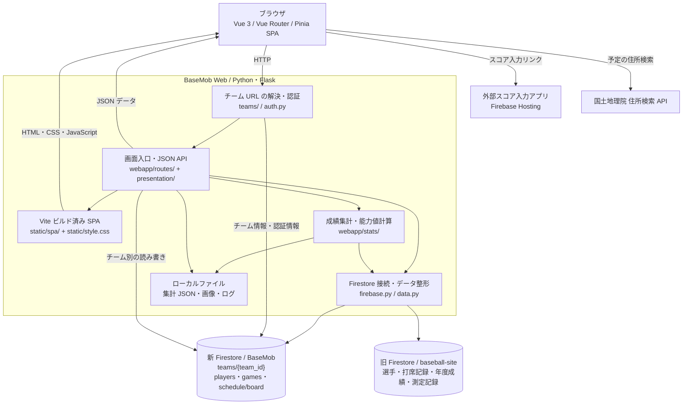

# BaseMob Web

野球チームの選手、試合結果、個人成績、能力値、日程・イベントの出欠を管理する Web アプリです。Python / Flask が JSON API と静的ファイルを提供し、Vue 3 の SPA が画面を描画し、Vue Router が画面遷移、Pinia が画面データを管理します。Cloud Firestore にチームごとのデータを保存します。

画面定義・画面遷移・データ定義・ビジネスルール・API 定義は [設計書](01.doc/design/README.md) を参照してください。

## 主な機能

- 選手一覧、選手の登録・編集、選手画像のアップロード
- 選手詳細、年度別・当年成績、過去の記録、能力値・最近の調子の表示
- 試合一覧・詳細、打者・投手成績、チーム成績の表示
- 試合のスコアボード画像のアップロード、YouTube URL の登録
- 日程調整、試合予定、イベント管理、出欠回答
- 規定打席の係数と定性的な特殊能力の設定
- チーム別 URL とチーム共通のログイン認証
- 外部のスコア入力アプリへのリンク

## システム構成図



構成図はリポジトリの実装を示しています。外部スコア入力アプリのコードと Flask の本番ホスティング設定は、このリポジトリには含まれていません。

### データの保存先

| 保存先 | 内容 |
| --- | --- |
| 新 Firestore `teams/{team_id}` | チーム名、URL 用 slug、ログイン ID、パスワードハッシュ、規定打席などの設定 |
| `teams/{team_id}/players/{player_id}` | チーム別の選手名簿、能力補正、特殊能力 |
| `teams/{team_id}/games/{game_id}` | 試合結果。投手データは `pitchers` サブコレクションまたは試合文書内にも対応 |
| `teams/{team_id}/schedule/board` | 日程・イベント・出欠を含む `poll` と、従来形式の予定 `items` |
| 旧 Firestore | `basic_info`、`players`、`game_records`、`annual_stats`、`annual_stats_detail`、`record_meeting` |
| `var/cache/players_data.json` / `var/cache/players_data_{team_id}.json` | 成績・能力値の集計キャッシュ。`RYUNEN` は `players_data.json` を使用 |
| `static/player_images/{slug}/` | アップロードした選手画像 |
| `static/scoreboard_images/{slug}/` | アップロードしたスコアボード画像 |
| `var/log/debug_log.txt` | アプリケーションログ |

現在は新旧 DB を併用しています。`webapp/data.py` の旧データ取得対象は旧 DB から読み込み、名簿・試合・日程などのチーム別データは新 DB を使用します。従来の打席記録の保存・更新・削除処理は新 DB のトップレベル `game_records` を操作するため、旧 DB からの読み込み先とは異なります。

`data/reference/schedule_data.csv` は拡張子が CSV ですが、予定の読み込み処理では JSON 配列として扱います。アプリの主データストアは Firestore です。

## 技術構成

| 用途 | 技術 |
| --- | --- |
| Web サーバー・JSON API | Flask 3.0.3 |
| フロントエンド・画面生成 | Vue 3 / Vue Router 4 / Pinia 3 / Vite 7 |
| データベース接続 | Firebase Admin SDK / Cloud Firestore |
| 成績集計 | pandas 2.2.3 / NumPy 2.1.2 |
| 認証 | HTTP Basic 認証、itsdangerous による署名付き Cookie、Werkzeug のパスワードハッシュ |
| CSV・表計算などの補助処理 | pandas / openpyxl / xlrd |

## ローカルでの起動

### 1. Python 環境と依存パッケージ

開発用には Python 3.12 を推奨します。各環境で新しい仮想環境を作成してください。

macOS / Linux:

```bash
python3 -m venv .venv
source .venv/bin/activate
python -m pip install -r requirements.txt
python -m pip install firebase-admin
```

Windows（PowerShell）:

```powershell
py -3.12 -m venv .venv
.\.venv\Scripts\Activate.ps1
python -m pip install -r requirements.txt
python -m pip install firebase-admin
```

現状の `requirements.txt` は UTF-16 形式です。また、アプリで必須の `firebase-admin` が記載されていないため、上記の追加インストールが必要です。

### 2. Firebase の認証鍵

対象プロジェクトの Firestore を利用できるサービスアカウント鍵を、`config/credentials/` に配置します。ディレクトリがなければ `mkdir -p config/credentials` で作成してください。

```text
basemob-web/
└── config/credentials/
    ├── firebase_key.json          # 新 DB（BaseMob）用
    └── firebase_key_notuse.json   # 旧 DB（baseball-site）用
```

ファイル名に `notuse` が含まれていますが、旧 DB の鍵も現在の起動処理で使用します。どちらかの初期化に失敗すると、実装上は両方の DB クライアントが無効になります。認証鍵は別途用意し、Git にコミットしないでください。

`.gitignore` の `firebase_key*.json` により、プロジェクト直下とサブディレクトリ内にある同名の鍵ファイルを Git 管理から除外しています。鍵を別名で保存する場合は、その名前も除外対象に追加してください。すでに追跡されているファイルには `.gitignore` は適用されません。

### 3. チーム情報の準備

既存チームを使う場合は、`teams/{team_id}` に `slug`、`login_id`、`password_hash` が設定されていることを確認します。新しいチームを作る場合は、サービスアカウントを設定したうえで次を実行します。

```bash
python -m webapp.create_team DEMO "デモチーム" demo-login "YOUR_TEAM_PASSWORD"
```

このコマンドは Firestore にチーム文書を書き込みます。既存のチーム ID またはログイン ID がある場合は作成を中止します。選手や試合のデータは作成しません。

### 4. アプリの起動

```bash
python app.py
```

`http://127.0.0.1:5000/t/demo/players` を開き、ブラウザの認証ダイアログで設定したログイン ID とパスワードを入力します。既存チームの場合は `demo` を対象チームの slug に置き換えます。

`/` や `/players` からログインすると、チーム別 URL へリダイレクトされます。ログインは署名付きの `team_login` Cookie に保持され、設定上の有効期間は30日です。

## 主な画面・API

以下のパスには `/t/{slug}` を付けてアクセスします。

| パス | 内容 |
| --- | --- |
| `/players` | 選手一覧 |
| `/register_player` / `/edit_player/{player_id}` | 選手登録・編集 |
| `/player_detail_R1/{player_id}` | 選手詳細・能力値 |
| `/current_year_stats/{player_id}` / `/player_history/{player_id}` | 当年成績・過去の記録 |
| `/games` / `/game/{game_id}` | 試合一覧・詳細 |
| `/teamstats` / `/pitchers` / `/annual_stats_detail` | チーム・投手・年度成績 |
| `/schedule` / `/events` | 日程調整・イベント |
| `/admin/regulation` / `/admin/qualitative_abilities` | 規定打席・特殊能力の設定 |
| `/csv_data` | 現実装では選手一覧へリダイレクト |
| `GET /api/schedule` / `POST /api/schedule/poll` | 日程取得・操作 |
| `GET・POST /api/events` | イベント取得・操作 |
| `POST /api/update_abilities` | 能力補正の更新 |

チームが存在する場合、日程・イベント画面と対応する API は未ログインでも利用できる公開経路を持ちます。操作ごとの認証条件はルート内で判定され、イベントの作成・編集・確定・削除と回答者設定などにはログインが必要です。

## ディレクトリ構成

```text
basemob-web/
├── app.py                  # ローカル起動の入口
├── requirements.txt        # Python 依存パッケージ
├── webapp/
│   ├── __init__.py         # Flask 初期化・ルート登録
│   ├── auth.py             # チーム認証・Cookie
│   ├── config.py           # パス・集計係数・認証関連の設定
│   ├── firebase.py         # 新旧 Firestore 接続
│   ├── data.py             # データ取得・DataFrame 整形
│   ├── teams/              # チーム解決・URL 接頭辞
│   ├── repositories/       # Firestore 参照・名簿・予定保存
│   ├── services/           # 選手データ合成・試合記録取得
│   ├── scheduling/         # 日付・回答者・日程・試合カード・イベント
│   ├── presentation/       # 静的シェル・画面データ API・JSON 変換
│   ├── routes/             # 画面入口・API のルート
│   ├── stats/              # 成績・能力値計算と JSON キャッシュ
│   ├── tenant.py           # 旧 import パスの互換入口
│   ├── schedule_poll.py    # 旧 import パスの互換入口
│   ├── create_team.py      # 旧チーム作成コマンドの互換入口
│   └── migrate_team.py     # 旧移行コマンドの互換入口
├── scripts/                # CSV 取り込み・チーム作成・移行
├── tests/                  # 模擬 DB による互換性テスト
├── client/                 # Vue SPA のソース・依存管理
│   ├── src/views/          # 18画面を担当する Vue コンポーネント
│   ├── src/components/     # ナビゲーション・表・出欠などの共通部品
│   ├── src/composables/    # 保存・日程 API 通信と終了時の後始末
│   ├── src/stores/         # Pinia の画面データ・読込状態
│   ├── src/scheduling/     # 日付・祝日・候補日計算
│   ├── src/router.js       # Vue Router の URL 定義
│   ├── tests/              # フロントエンドのテスト
│   └── vite.config.js      # ビルド・開発用 API プロキシ・テスト
├── static/
│   ├── spa/                # Flask が配信するビルド済み HTML・JS・CSS
│   ├── style.css           # 既存の共通スタイル
│   └── player_images/      # 選手画像などの静的資産
├── 01.doc/
│   ├── design/             # 設計書
│   └── assets/             # 設計・画面の参考画像
├── config/                 # 共通パス・Git 管理対象外の認証鍵
├── data/
│   ├── imports/            # CSV 取り込み入力
│   └── reference/          # 従来予定・参考データ
├── var/
│   ├── cache/              # 集計キャッシュ
│   └── log/                # 実行ログ（Git 管理対象外）
├── migrate.py              # 旧 CSV 取り込みコマンドの互換入口
├── upload_csv.py           # 旧年度成績取り込みコマンドの互換入口
└── backups/                # チーム移行前のバックアップ
```

## 運用・補助スクリプト

- `webapp/config.py` で規定打席の既定値やログ出力先、署名用 `SECRET_KEY` などを設定します。実際のチームログイン情報は Firestore のチーム文書を参照します。環境変数や `.env` による設定読み込みは実装されていません。
- `app.py` はデバッグ有効のローカル開発用サーバーです。本番運用ではデバッグを無効にした WSGI サーバーと HTTPS、固有の署名鍵を用意してください。
- 画像、集計キャッシュ、ログはサーバーのローカルファイルに書き込みます。運用先では`var/` への書き込み権限と、画像を保持する永続ストレージが必要です。
- `python migrate.py` は`data/imports/` の CSV を新 DB のトップレベルコレクションへ取り込みます。チーム別のサブコレクションへの移行ではありません。
- `python upload_csv.py` は旧 DB の `annual_stats` を一度削除してから CSV データを再登録します。実行前に接続先とバックアップを確認してください。
- `python -m webapp.migrate_team` は `RYUNEN` 専用です。名簿・試合件数などの固定条件を確認し、`backups/` に移行前のデータを保存します。汎用のチーム作成には `create_team` を使用してください。

## トラブルシューティング

### GitHub への push と認証鍵

HTTPS の Git 操作では GitHub アカウントのパスワードは使用できません。GitHub CLI のブラウザ認証を使用する場合は、次の手順で設定します（macOS / Homebrew）。

```bash
brew install gh
gh auth login --hostname github.com --git-protocol https --web
gh auth setup-git
git push origin main
```

ブラウザでリポジトリへの書き込み権限を持つアカウントにログインします。詳しくは [GitHub CLI の認証手順](https://cli.github.com/manual/gh_auth_login) を参照してください。

`GH013` / `Push cannot contain secrets` と表示された場合は、GitHub Push Protection が送信対象のコミット内に認証鍵を検出しています。現在のファイルを削除したり `.gitignore` を追加したりするだけでは、過去のコミットにある鍵は除去されません。鍵が含まれるすべてのコミットから除外する必要があります。[GitHub の対応手順](https://docs.github.com/en/code-security/how-tos/secure-your-secrets/work-with-leak-prevention/push-protection-on-the-command-line)

このリポジトリでは、初回コミットに含まれていた `zip/firebase_key.json` と `zip/firebase_key_notuse.json` を `main` の履歴から除外し、ローカルファイルを保持したうえで `.gitignore` を追加しました。その後、旧コピーの `zip/` を整理し、鍵は一度プロジェクト直下へ移し、現在は `config/credentials/` に配置しています。履歴変更時の旧コミットはローカルのバックアップ参照 `refs/original/refs/heads/main` に残っているため、その参照には鍵が含まれます。`git push origin main` ではこのバックアップ参照は送信されません。旧履歴を含む `git push --mirror` やバックアップの共有は避けてください。

実際の認証鍵を検出された場合は、保護の解除リンクで公開を許可せず、履歴から除外してください。漏えい対策として対象のサービスアカウント鍵を Google Cloud 側で失効・再発行し、ローカルの鍵ファイルも更新することを推奨します。

### アプリの起動・データ表示

| 症状 | 確認事項 |
| --- | --- |
| `ModuleNotFoundError: firebase_admin` | 仮想環境を有効化し、`python -m pip install firebase-admin` を実行する |
| 起動時に Firebase 接続エラーが出る | 2つの鍵ファイルの配置、対象プロジェクト、Firestore の利用権限を確認する |
| 認証が通らない | 新 DB のチーム文書の `slug`、`login_id`、`password_hash` を確認する |
| 名簿や試合が空になる | 対象チームの `players`・`games` サブコレクションとログを確認する |
| 過去成績・能力値が表示されない | 旧 DB のデータ、集計キャッシュ、`var/log/debug_log.txt` を確認する。空の新チームには過去データは自動作成されない |
| 画像やキャッシュを保存できない | `var/` と `static/` 配下の書き込み権限を確認する |

本番デプロイの設定は含まれていません。


## SPA の開発・ビルド・確認

フロントエンドの開発には Node.js 22.22.2 以上の 22 系、または 24.15.0 以上の 24 系を使用してください。依存バージョンは `client/package-lock.json` で固定しています。

```bash
cd client
npm ci
npm test
npm run build
```

`npm run build` は `static/spa/` に配信ファイルを出力します。ビルド結果も Git 管理するため、Python サーバーの通常起動に Node.js は不要です。フロントエンドを変更したときはソースとビルド結果を一緒に更新してください。

開発時はリポジトリ直下で `python app.py` を起動し、別のターミナルで次を実行します。

```bash
cd client
npm run dev
```

`http://127.0.0.1:5173/t/{slug}/players` を開きます。Vite はチーム付き API と既存静的資産を Flask の `127.0.0.1:5000` へ転送し、Vue の変更を即時反映します。認証は既存の Basic 認証・署名 Cookie を使用します。Flask の接続先を変更する場合は、Vite 起動時に `BASEMOB_API_TARGET` を指定します。

Python の確認はリポジトリ直下、仮想環境を有効にした状態で実行します。テストは模擬 DB を使い、実 Firestore や認証鍵へアクセスしません。

```bash
python -m unittest discover -s tests -v
```

運用処理の実装は `scripts/` にあります。既存の `python migrate.py`、`python upload_csv.py`、`python -m webapp.create_team`、`python -m webapp.migrate_team` も引き続き使用できます。[構成変更の対応表](01.doc/design/structure.md) を参照してください。

## SPA と API の連携

最初のアクセスでは Flask から共通の静的 HTML を取得します。その後は Vue Router が既存の `/t/{slug}/...` URL で画面を切り替え、`/t/{slug}/api/screens/{画面パス}` から取得した JSON を Vue コンポーネントへ渡します。内部リンク、保存後の移動、ブラウザの戻る・進むで HTML 全体を読み直しません。既存18画面の直接アクセス・再読み込みにも Flask が対応します。

画面 URL、認証方式、サーバーの成績計算、DB 保存先、既存 API は維持しています。フォームは FormData、日程・イベント・能力補正は JSON を使います。日程とイベントの状態・イベント処理も Vue が管理し、画面終了時は通信を中断します。JavaScript が必要です。

詳しくは [SPA と API の設計](01.doc/design/api-client.md) を参照してください。

全画面を白いカード、控えめな枠線・影、ゆとりある余白のモダンなデザインで統一しています。選手詳細の選手情報部分はパワプロ風デザインを維持し、上部ヘッダーと余白は他ページと共通です。「トップページへ戻る」ボタンは廃止しています。ホーム上部のタブは全18画面に共通で表示し、読み込み中・API エラー時にも利用できます。

直下には README、依存定義、起動入口、Git 設定、既存の互換コマンドを残します。ファイル配置は [構成変更の対応表](01.doc/design/structure.md)、データの用途は [data/README](data/README.md)、認証鍵は [config/README](config/README.md)、実行時ファイルは [var/README](var/README.md) を参照してください。
