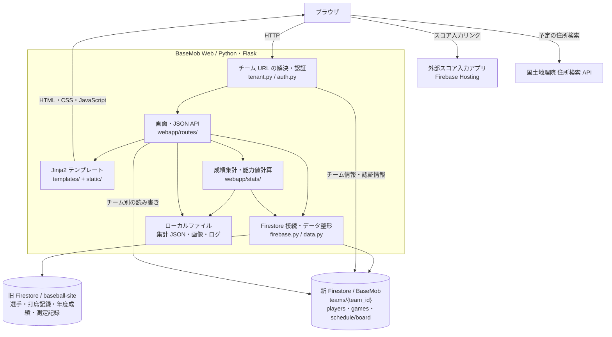

# BaseMob Web

野球チームの選手、試合結果、個人成績、能力値、日程・イベントの出欠を管理する Web アプリです。Python / Flask で画面と API を提供し、Cloud Firestore にチームごとのデータを保存します。

## 主な機能

- 選手一覧、選手の登録・編集、選手画像のアップロード
- 選手詳細、年度別・当年成績、過去の記録、能力値・最近の調子の表示
- 試合一覧・詳細、打者・投手成績、チーム成績の表示
- 試合のスコアボード画像のアップロード、YouTube URL の登録
- 日程調整、試合予定、イベント管理、出欠回答
- 規定打席の係数と定性的な特殊能力の設定
- チーム別 URL とチーム共通のログイン認証
- 外部のスコア入力アプリへのリンク

## システム構成図



構成図はリポジトリの実装を示しています。外部スコア入力アプリのコードと Flask の本番ホスティング設定は、このリポジトリには含まれていません。

### データの保存先

| 保存先 | 内容 |
| --- | --- |
| 新 Firestore `teams/{team_id}` | チーム名、URL 用 slug、ログイン ID、パスワードハッシュ、規定打席などの設定 |
| `teams/{team_id}/players/{player_id}` | チーム別の選手名簿、能力補正、特殊能力 |
| `teams/{team_id}/games/{game_id}` | 試合結果。投手データは `pitchers` サブコレクションまたは試合文書内にも対応 |
| `teams/{team_id}/schedule/board` | 日程・イベント・出欠を含む `poll` と、従来形式の予定 `items` |
| 旧 Firestore | `basic_info`、`players`、`game_records`、`annual_stats`、`annual_stats_detail`、`record_meeting` |
| `players_data.json` / `players_data_{team_id}.json` | 成績・能力値の集計キャッシュ。`RYUNEN` は `players_data.json` を使用 |
| `static/player_images/{slug}/` | アップロードした選手画像 |
| `static/scoreboard_images/{slug}/` | アップロードしたスコアボード画像 |
| `debug_log.txt` | アプリケーションログ |

現在は新旧 DB を併用しています。`webapp/data.py` の旧データ取得対象は旧 DB から読み込み、名簿・試合・日程などのチーム別データは新 DB を使用します。従来の打席記録の保存・更新・削除処理は新 DB のトップレベル `game_records` を操作するため、旧 DB からの読み込み先とは異なります。

`schedule_data.csv` は拡張子が CSV ですが、予定の読み込み処理では JSON 配列として扱います。`baseball.db` と `database.py` は SQLite 用の補助ファイルで、現在の Flask アプリの主データストアは Firestore です。

## 技術構成

| 用途 | 技術 |
| --- | --- |
| Web サーバー・画面生成 | Flask 3.0.3 / Jinja2 |
| フロントエンド | HTML / CSS / JavaScript |
| データベース接続 | Firebase Admin SDK / Cloud Firestore |
| 成績集計 | pandas 2.2.3 / NumPy 2.1.2 |
| 認証 | HTTP Basic 認証、itsdangerous による署名付き Cookie、Werkzeug のパスワードハッシュ |
| CSV・表計算などの補助処理 | pandas / openpyxl / xlrd / Beautiful Soup / requests |

## ローカルでの起動

### 1. Python 環境と依存パッケージ

開発用には Python 3.12 を推奨します。同梱の `venv/` は Windows 用の構成なので、各環境で新しい仮想環境を作成してください。

macOS / Linux:

```bash
python3 -m venv .venv
source .venv/bin/activate
python -m pip install -r requirements.txt
python -m pip install firebase-admin
```

Windows（PowerShell）:

```powershell
py -3.12 -m venv .venv
.\.venv\Scripts\Activate.ps1
python -m pip install -r requirements.txt
python -m pip install firebase-admin
```

現状の `requirements.txt` は UTF-16 形式です。また、アプリで必須の `firebase-admin` が記載されていないため、上記の追加インストールが必要です。

### 2. Firebase の認証鍵

対象プロジェクトの Firestore を利用できるサービスアカウント鍵を、プロジェクト直下に配置します。

```text
basemob-web/
├── app.py
├── firebase_key.json          # 新 DB（BaseMob）用
└── firebase_key_notuse.json   # 旧 DB（baseball-site）用
```

ファイル名に `notuse` が含まれていますが、旧 DB の鍵も現在の起動処理で使用します。どちらかの初期化に失敗すると、実装上は両方の DB クライアントが無効になります。認証鍵は別途用意し、Git にコミットしないでください。

### 3. チーム情報の準備

既存チームを使う場合は、`teams/{team_id}` に `slug`、`login_id`、`password_hash` が設定されていることを確認します。新しいチームを作る場合は、サービスアカウントを設定したうえで次を実行します。

```bash
python -m webapp.create_team DEMO "デモチーム" demo-login "YOUR_TEAM_PASSWORD"
```

このコマンドは Firestore にチーム文書を書き込みます。既存のチーム ID またはログイン ID がある場合は作成を中止します。選手や試合のデータは作成しません。

### 4. アプリの起動

```bash
python app.py
```

`http://127.0.0.1:5000/t/demo/players` を開き、ブラウザの認証ダイアログで設定したログイン ID とパスワードを入力します。既存チームの場合は `demo` を対象チームの slug に置き換えます。

`/` や `/players` からログインすると、チーム別 URL へリダイレクトされます。ログインは署名付きの `team_login` Cookie に保持され、設定上の有効期間は30日です。

## 主な画面・API

以下のパスには `/t/{slug}` を付けてアクセスします。

| パス | 内容 |
| --- | --- |
| `/players` | 選手一覧 |
| `/register_player` / `/edit_player/{player_id}` | 選手登録・編集 |
| `/player_detail_R1/{player_id}` | 選手詳細・能力値 |
| `/current_year_stats/{player_id}` / `/player_history/{player_id}` | 当年成績・過去の記録 |
| `/games` / `/game/{game_id}` | 試合一覧・詳細 |
| `/teamstats` / `/pitchers` / `/annual_stats_detail` | チーム・投手・年度成績 |
| `/schedule` / `/events` | 日程調整・イベント |
| `/admin/regulation` / `/admin/qualitative_abilities` | 規定打席・特殊能力の設定 |
| `/csv_data` | ローカル CSV の確認 |
| `GET /api/schedule` / `POST /api/schedule/poll` | 日程取得・操作 |
| `GET・POST /api/events` | イベント取得・操作 |
| `POST /api/update_abilities` | 能力補正の更新 |

チームが存在する場合、日程・イベント画面と対応する API は未ログインでも利用できる公開経路を持ちます。操作ごとの認証条件はルート内で判定され、イベントの作成・編集・確定・削除と回答者設定などにはログインが必要です。

## ディレクトリ構成

```text
basemob-web/
├── app.py                  # ローカル起動の入口
├── requirements.txt        # Python 依存パッケージ
├── webapp/
│   ├── __init__.py         # Flask 初期化・ルート登録
│   ├── config.py           # パス・集計係数・認証関連の設定
│   ├── auth.py             # チーム認証・Cookie
│   ├── tenant.py           # チーム別 URL・Firestore 参照
│   ├── firebase.py         # 新旧 Firestore 接続
│   ├── data.py             # データ取得・DataFrame 整形
│   ├── schedule_poll.py    # 日程・イベント・出欠の処理
│   ├── routes/             # 画面・API のルート
│   ├── stats/              # 成績・能力値の計算と JSON キャッシュ
│   ├── create_team.py      # チーム作成用 CLI
│   └── migrate_team.py     # 既存チーム専用の移行処理
├── templates/              # Jinja2 テンプレート・画面部品
├── static/                 # CSS・JavaScript・画像
├── players_data.json       # 集計キャッシュ
├── *.csv                   # 取り込み用・参照用のローカルデータ
├── migrate.py              # CSV → 新 Firestore の取り込み
├── upload_csv.py           # CSV → 旧 Firestore の年度成績再取り込み
└── backups/                # チーム移行前のバックアップ
```

## 運用・補助スクリプト

- `webapp/config.py` で規定打席の既定値やログ出力先、署名用 `SECRET_KEY` などを設定します。実際のチームログイン情報は Firestore のチーム文書を参照します。環境変数や `.env` による設定読み込みは実装されていません。
- `app.py` はデバッグ有効のローカル開発用サーバーです。本番運用ではデバッグを無効にした WSGI サーバーと HTTPS、固有の署名鍵を用意してください。
- 画像、集計キャッシュ、ログはサーバーのローカルファイルに書き込みます。運用先では書き込み権限と、画像を保持する永続ストレージが必要です。
- `python migrate.py` はルート直下の CSV を新 DB のトップレベルコレクションへ取り込みます。チーム別のサブコレクションへの移行ではありません。
- `python upload_csv.py` は旧 DB の `annual_stats` を一度削除してから CSV データを再登録します。実行前に接続先とバックアップを確認してください。
- `python -m webapp.migrate_team` は `RYUNEN` 専用です。名簿・試合件数などの固定条件を確認し、`backups/` に移行前のデータを保存します。汎用のチーム作成には `create_team` を使用してください。
- `python database.py` は SQLite の `players` テーブルを削除して初期データを作ります。Firestore アプリの起動には不要です。

## トラブルシューティング

| 症状 | 確認事項 |
| --- | --- |
| `ModuleNotFoundError: firebase_admin` | 仮想環境を有効化し、`python -m pip install firebase-admin` を実行する |
| 起動時に Firebase 接続エラーが出る | 2つの鍵ファイルの配置、対象プロジェクト、Firestore の利用権限を確認する |
| 認証が通らない | 新 DB のチーム文書の `slug`、`login_id`、`password_hash` を確認する |
| 名簿や試合が空になる | 対象チームの `players`・`games` サブコレクションとログを確認する |
| 過去成績・能力値が表示されない | 旧 DB のデータ、集計キャッシュ、`debug_log.txt` を確認する。空の新チームには過去データは自動作成されない |
| 画像やキャッシュを保存できない | プロジェクト直下と `static/` 配下の書き込み権限を確認する |

このリポジトリには自動テストや本番デプロイの設定は含まれていません。
