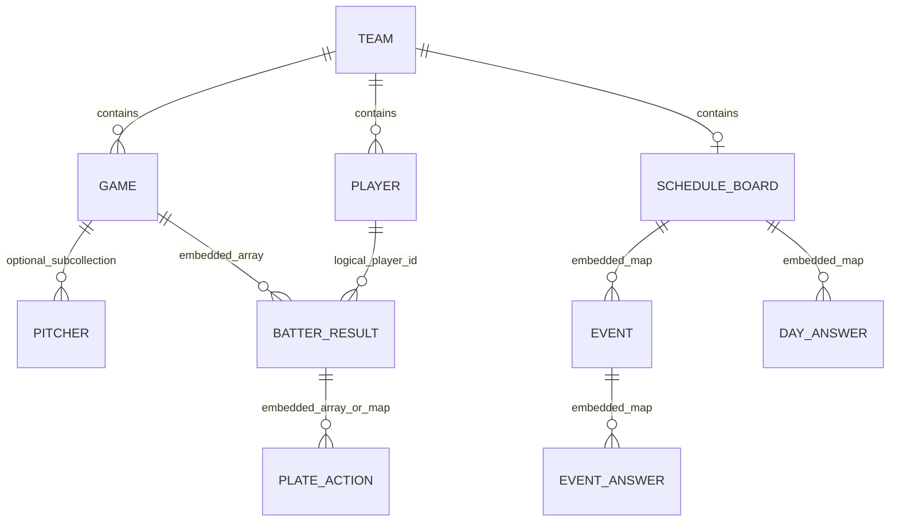

# データ・テーブル定義

[設計書トップ](README.md) / [ビジネスルール](business-rules.md)

## 定義の前提

主 DB は Cloud Firestore です。以下では RDB のテーブルに相当する単位をコレクション、行をドキュメント、列をフィールドとして定義します。外部キー、NOT NULL、列型、ユニーク制約は DB スキーマとして定義されていません。「必須」はアプリが通常の書き込みや読み込みで必要とする条件です。実データに存在する全フィールドを列挙したものではありません。

## 論理構造



図の選手との関連は論理参照です。参照整合性は DB で強制されず、名前による照合や ID がないデータも扱います。`BATTER_RESULT`、`PLATE_ACTION`、`EVENT`、回答は独立したコレクションではありません。

```text
新 DB（db）
├── teams/{team_id}
│   ├── players/{player_id}
│   ├── games/{game_id}
│   │   └── pitchers/{pitcher_doc_id}   # 試合詳細で参照
│   └── schedule/board
│       ├── items                      # 従来形式の配列
│       └── poll                       # 日程・試合カード・イベント・出欠
└── game_records/{auto_id}             # 従来打席フォームの書込先

旧 DB（db_old）
├── basic_info/{doc_id}
├── players/{doc_id}
├── game_records/{doc_id}
├── annual_stats/{doc_id}
├── annual_stats_detail/{doc_id}
└── record_meeting/{doc_id}
```

## 新 DB: teams

キー: `team_id`（ドキュメント ID）。作成 CLI は空の ID を拒否します。既存 ID と既存ログイン ID は作成前に照合しますが DB のユニーク制約ではありません。

| フィールド | 型 | 条件・初期値・用途 |
| --- | --- | --- |
| `name` | string | チーム表示名。読取時の欠損はドキュメント ID |
| `slug` | string | チーム URL に使用。作成時は `team_id.lower()`、読取時は空白除去・小文字化 |
| `login_id` | string | Basic 認証のユーザー名。空では認証不可 |
| `password_hash` | string | Werkzeug で生成するパスワードハッシュ。平文パスワードを保存しない |
| `paPerGame` | number | 規定打席係数。作成時1.8、設定画面は0超20以下 |
| `reqGames` | integer | 作成時1。チーム情報として取得されるが、全画面の最低試合数制約を保証しない |
| `reqAb` | integer | 作成時2。同上 |
| `ability_kinds` | array of map | 特殊能力種類 `{key, label}`。既定は `qual_sayonara` / サヨナラ男 |

根拠: `webapp/teams/context.py:_load_teams`、`create_team.py`、`routes/regulation.py`、`routes/qualitative_abilities.py`。

## 新 DB: teams/{team_id}/players

キー: `str(player_id)`。登録時は現名簿の最大 ID + 1、空なら1。名簿読取では文書内 `player_id`、なければ文書 ID を整数化します。変換できない文書は一覧から除外します。

| フィールド | 型 | 条件・用途 |
| --- | --- | --- |
| `player_id` | integer | 登録時に生成。編集 API は ID の存在・整合性を強制しない |
| `name` | string | 登録時必須、編集時のサーバー必須検証なし |
| `number` | string / number | 背番号。登録フォームは文字列保存、登録時必須 |
| `no` | string / number | 旧形式の背番号。登録時 `number` と同値、一覧は `number` 欠損時に参照 |
| `pos1` / `pos2` / `pos3` | string | 主・副ポジション |
| `pitch_bat` | string | 投打の結合文字列。例 `右投左打` |
| `birth_date` | string | 生年月日。編集画面は YYYY-MM-DD を案内 |
| `image_path` | string | `static/` 相対パス。既定 `default.png` |
| `plus_meet` | integer | ミート補正。API は0～16 |
| `plus_power` | integer | パワー補正。同上 |
| `plus_speed` | integer | 走力補正。同上 |
| `plus_arm` | integer | 肩力補正。同上 |
| `plus_defense` | integer | 守備力補正。同上 |
| `plus_catching` | integer | 捕球補正。同上 |
| `qual_sayonara` / `qual_{8桁hex}` | boolean（画面保存） | 定性特殊能力の選択状態。読取は一部文字列フラグにも対応 |

`number` の編集では `no` を同時更新しません。属性更新は merge 保存のため、未送信の項目や別の能力値は保持します。`load_player_shell` は JSON の属性に名簿の非空属性と `plus_`・`qual_` を重ねます。

## 新 DB: teams/{team_id}/games

キー: `game_id`（string）。このアプリに試合そのものの新規作成 API はありません。外部アプリが作成する文書を参照するため、フィールドは読み込み互換形式を示します。

| フィールド | 想定型 | 用途・互換形式 |
| --- | --- | --- |
| `date` | string | 試合日。年絞込は先頭4文字、並び替えは文字列順 |
| `opponent` | string | 対戦相手 |
| `gameType` | string | `official` / `公式戦` 等。チーム成績の区分は `tournament` にもフォールバック |
| `tournament` | string | 大会等の互換項目 |
| `stadium` | string | 球場 |
| `result` | string | `W` 勝利、`L` 敗戦、その他はチーム成績で引分扱い |
| `scoreMy` / `scoreOpp` | number / numeric string | 自チーム / 相手得点 |
| `results` | array of map | 選手別打撃成績・打席 |
| `batters` | array of map | 試合詳細の `results` 欠損時の互換形式 |
| `pitchers` | array of map | 試合文書内の投手成績 |
| `opp_pitcher_arm` | string | `L` の場合、打席の対左フラグに利用 |
| `scoreboard_image` | string | ローカル画像の `static/` 相対パス |
| `youtube_url` | string | 動画リンク。保存時 HTTP(S)、500文字以下 |

### 打者 result オブジェクト

| フィールド | 型 | 用途 |
| --- | --- | --- |
| `player_id` / `id` | integer / string | 選手 ID。欠損時は名前で照合する処理あり |
| `name` | string | 選手名 |
| `order` | integer / string | 打順。試合詳細の非数値はソートキー99 |
| `position` | string | 守備位置 |
| `stats` | map | 手入力集計値。各値は選手オブジェクト直下にも対応 |
| `actions` / `atBats` / `details` | array / map | 打席の互換フィールド。処理によって文字列にも対応 |

試合詳細の集計値は `PA`、`AB`、`H`、`HR`、`RBI`、`RUNS`、`SB`、`BH2`、`BH3`、`RISP_AB`、`RISP_H`、`K`、`BB`、`HBP`、`SAC`、`SF`、`DP`、`ERR`、`defensive_errors`。小文字や `hits`、`at_bats`、`homeruns` 等の互換名も参照します。打席から再計算できる値と手入力値は項目ごとに大きい方を採用する処理があります。

### 打席 action オブジェクト

| フィールド | 型 | 用途 |
| --- | --- | --- |
| `action` / `result` / `name` / `text` / `b_result` | string | 打席結果。対応する互換名は集計処理ごとに異なる |
| `direction` / `hit_direction` / `dir` | string | 打球方向 |
| `runners` / `case` / `base` / `situation` | string | 走者状況 |
| `strikes` / `s` | string / integer | ストライク数 |
| `rbi` / `point` / `points` | integer / numeric string | 打点 |
| `run` / `score` | boolean等 | 得点フラグ |
| `vs_left` | boolean / integer / string | 対左フラグ。未指定時は試合の相手投手属性参照 |
| `advancing_runner` / `adv` | boolean等 | 進塁フラグ |

### 投手オブジェクト / pitchers サブコレクション

| フィールド | 想定型 | 用途 |
| --- | --- | --- |
| `name` | string | 投手集計のキー（名前） |
| `outs` / `out` | integer | 取得アウト数。`out` は試合詳細のみの互換名 |
| `hits` / `hr` / `bb` / `hbp` | integer | 被安打・被本塁打・四球・死球 |
| `so` / `k` | integer | 奪三振 |
| `runs` / `er` | integer | 失点 / 自責点。失点欠損時は自責点を使用 |
| `cg` | boolean | 完投フラグ |

試合詳細はサブコレクションが空でなければそちらを優先します。投手一覧は文書内の配列のみを使用します。勝利・敗戦・セーブ・完封の集計箱はありますが、現在の投手一覧処理で加算されません。

## 新 DB: teams/{team_id}/schedule/board

文書 ID は固定 `board`。`items` は従来予定の配列、`poll` は現在の日程・イベント状態です。現在の API は Firestore トランザクションで `poll` フィールド全体を置換します。

### poll

| フィールド | 型 | 定義 |
| --- | --- | --- |
| `removed` | array of date string | 基本日程から除外した日。正規化時は重複除去・昇順・最大80 |
| `added` | array of date string | 手動追加した日。操作時は最大62、正規化時は最大80 |
| `answers` | map | `{日付: {回答者ID: 回答}}` |
| `games` | map | `{日付: 試合カード}`。同日1枚 |
| `events` | map | `{event_id: イベント}`。最大40件 |
| `answerPeople` | array of map / null | 日程回答者。null は名簿を使用、空配列は明示的な空リスト |
| `eventPeople` | array of map / null | イベント回答者。同上 |

回答者リストは `{id: string, name: string}`、最大60。ID は選手の数字文字列または `m:` + 8桁 hex。自由入力回答の ID は `n:` + 空白除去した名前（最大40文字）です。

### 回答

| フィールド | 型 | 定義 |
| --- | --- | --- |
| `status` | string | 日程: `all`・`am`・`pm`・`pending`・`out`。イベント: `in`・`pending`・`out` |
| `by` | date string | 未定時の回答期日。必須、2000～2100年 |
| `name` | string | 手動回答者や自由入力回答者の表示名。最大40文字 |

`status` が空の更新入力は回答削除を意味します。保存時の正規化で不正回答・不正キーは除外します。

### 試合カード

| フィールド | 型 | 制約・既定値 |
| --- | --- | --- |
| `slot` | string | 必須、`am` / `pm` |
| `opponent` / `stadium` | string | 各80文字 |
| `eventName` | string | `公式戦` / `練習試合`。無効値は練習試合 |
| `address` | string | 120文字 |
| `uniform` | string | `黒` / `青`。無効値は黒 |
| `bat` | string | `ウレタン可` / `金属・木製のみ` / `情報なし`。無効値は情報なし |
| `timeGather` / `timePB` | string | HH:mm、無効値は空 |
| `bench` | string | 500文字 |
| `lineup` | array of map | 常に10枠。要素 `{n, p, player_id?}` |

打順枠の `n` は最大40文字、`p` は空・投・捕・一・二・三・遊・左・中・右・DH。保存時に名簿の空白除去名と一致すれば `player_id` を付与します。

### イベント

キー: 8桁の小文字 hex。作成時にランダム生成。

| フィールド | 型 | 制約・用途 |
| --- | --- | --- |
| `name` | string | 必須、最大40文字 |
| `place` | string | 最大80文字 |
| `address` | string | 最大120文字 |
| `timeStart` | string | HH:mm、無効値は空 |
| `note` | string | 最大500文字 |
| `dates` | array of date string | 1～14日。重複除去、昇順 |
| `answers` | map | `{候補日: {回答者ID: 回答}}` |
| `confirmed` | boolean | 初期 false、確定時 true。確定解除 API なし |

### 保存例（架空データ）

```json
{
  "poll": {
    "removed": [],
    "added": ["2026-10-25"],
    "answers": {"2026-10-25": {"1": {"status": "all"}}},
    "games": {},
    "events": {
      "a1b2c3d4": {
        "name": "懇親会", "place": "会場A", "address": "", "timeStart": "18:00",
        "note": "", "dates": ["2026-11-01"], "answers": {}, "confirmed": false
      }
    },
    "answerPeople": null,
    "eventPeople": null
  }
}
```

## 従来打席 game_records

新 DB のトップレベルへの保存・更新・削除、旧 DB のトップレベルからの読み込みに使用されます。キーは保存時の自動生成 ID。画面上の `csv_index` は実際には Firestore の文書 ID です。

| フィールド | 保存・参照型 | 内容 |
| --- | --- | --- |
| `player_id` | integer | 選手 ID |
| `game_date` / `game_id` / `stadium` | string | 試合日 / 試合番号 / 球場 |
| `game_type` / `batting_order` / `fielding_position` | string | 既定 official / sub / PR |
| `result` / `direction` / `runner` / `strikes` | string | 打席結果 / 方向 / 走者 / ストライク |
| `vs_left` / `sayonara` | string / integer | 打席フラグ |
| `sb` / `runs` / `rbi` / `errors` / `gidp` | integer | 新規保存時は試合合計を最初の打席だけに記録 |
| `is_official` / `is_4th_bat` / `is_hr` / `advancing_runner` / `multi_hit` | string | 更新フォームはチェック有無を `1` / `0` として保存 |
| `bases` | string / number | 旧データの塁打数 |

## 旧 DB と CSV の参照項目

`data.py` は列名の前後空白を除去し、`player_id`・`選手id`・`id` を `player_id` に寄せます。各値を文字列化して末尾 `.0` と `nan` を整理し、選手 ID は整数に変換します。以下は同梱 CSV のヘッダーとコードで確認した項目です。

| コレクション | 主要項目 | 用途 |
| --- | --- | --- |
| `basic_info` | `player_id,name,number,pos1,pos2,pos3,image_path,birth_date,pitch_bat,character,status,created_at,updated_at,plus_*,dan,catcher,throw,injury,team` | 測定記録と選手名の結合など |
| `players` | 上記選手属性・補正等。`position_main,position_sub1,position_sub2,number` は `pos1,pos2,pos3,no` に変換 | 過去成績・能力集計の基礎名簿 |
| `annual_stats` | `season_stat_id,player_id,year,games,batting_average,plate_apperances,at_bats,hits,homeruns,runs_batted_in,scores,stolen_bases,obp,slg,batting_average_in_scoring_position,OPS,doubles,triples,total_bases,strike_outs,bb,hbp,sacrifice_bants,sacrifice_flies,double_plays,errors_by_opponents,errors,steal_base_prevention,created_at,updated_at` | 年度成績。スペルは既存 CSV に合わせる |
| `record_meeting` | `player_id,record_date,throw_distance,batting_distance,run_short,run_long,pitch_speed,memo,created_at,updated_at` | 投・打・走の測定、能力計算 |
| `annual_stats_detail` | 旧 DB 読取対象名として登録 | このアプリの取得コードから固定スキーマは確定できない |

`upload_csv.py` の年度成績文書 ID は `{player_id}_{year}`。`migrate.py` の ID 指定対象は CSV の選手 ID、未指定コレクションは自動 ID。データ移行先はそれぞれのスクリプトで異なります。

## ローカルファイル・派生データ

| パス | 形式・役割 |
| --- | --- |
| `var/cache/players_data.json` | 選手辞書の JSON 配列。チーム未指定 / RYUNEN 用 |
| `var/cache/players_data_{team_id}.json` | その他チームのキャッシュ。未生成なら読取は空配列 |
| `static/player_images/{slug}/{player_id}.{ext}` | 選手画像。jpeg は jpg に変換したファイル名で保存 |
| `static/scoreboard_images/{slug}/{game_id相当}.{ext}` | スコアボード画像。ファイル名の禁止文字を置換 |
| `data/reference/schedule_data.csv` | 従来の予定 `items` の読み込みフォールバック。内容は JSON 配列 |
| `var/log/debug_log.txt` | DEBUG レベルの追記ログ |
| `backups/ryunen-{timestamp}/before.pkl` | 専用移行処理前のチーム・選手・試合・予定の pickle バックアップ |

キャッシュは元属性に `id`、`age`、`holding_points`、能力値（`meet_val,power_val,speed_val,arm_val,defense_val,catch_val`）、ランク・特殊能力・成績等を追加します。手動編集用の主データではありません。`update_json_from_csv` という名称ですが、現在の集計入力は主に Firestore です。
